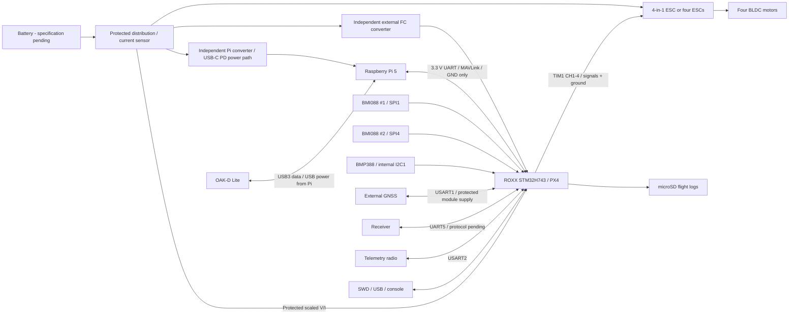

# ROXX architecture recommendation — Stage 2

**Status: partial — preliminary engineering architecture, awaiting critical-pin/sourcing/power approval. No schematic or PCB implementation.**  
2026-10-18. Evidence keys link to [sources.md](sources.md); alternatives in [architecture_decision_matrix.md](architecture_decision_matrix.md). “Verified” means inspected source/specification, **not** verified physical performance.

## 1. Fixed product boundary

New custom ROXX PCB, PX4 real-time flight control, external GNSS, four BLDC/ESC channels, Pi 5 companion, OAK-D Lite directly on Pi USB. These user decisions are final. The original NXT board is reference material only. Companion loss must not prevent FC sensor acquisition, rate/attitude control, RC response or configured immediate failsafes.

Supply domains share a deliberate signal reference, **not a shared high-current FC connector or Pi return trace**. ESC/Pi power return loops go to distribution, outside sensor return paths.

## 2. Upstream support status — verified correction to Stage 1

**`hkust_nxt-dual_default` is real.** Official PX4 has `boards/hkust/nxt-dual` at both:

* Latest stable reported by GitHub API: **v1.17.0**, commit `d6f12ad1c4f70ad3230afd7d86e971421e02fef4` [P1/P2]. Release asset names include `hkust_nxt-dual_default.px4` and `hkust_nxt-dual_bootloader.px4`.
* Current main observed: `ddcaad6601be20453ec6acd0f08e567af3a7e1bb` [P3]. Target still exists and receives changes (including 2026-10 reset handling).

The board config selects H743VI, Cortex-M7, BMI088, DShot/PWM, serial roles and common barometers. Startup explicitly starts both BMI088s. This establishes **upstream source and distributed release-artifact presence**, not a local successful build, QGC detection test, support-category certification, exact correspondence to imported PCB revision, or flight-readiness. No build was attempted in Stage 2.

Stage 1 correctly found no firmware inside the imported checkout but had not searched upstream. Its firmware-absence finding must not be interpreted as “no PX4 target exists.” See appended audit correction.

**Recommendation:** use official stable v1.17.0 as an initial reproducible reference, audit/backport relevant main safety fixes, and create a distinct future `roxx_fc-v1_default` + `roxx_fc-v1_bootloader` target. Neither target exists yet. Do not flash NXT firmware onto redesigned ROXX hardware.

## 3. Proposed core and sensors

* **STM32H743VIT6**, 2 MB flash LQFP100, 3.3 V logic [M1/ST1]. Same logical H743VI as NXT, inspectable pins instead of BGA; raw processing power is not the selection basis. Enough USART/SPI/I2C/timer/SD resources shown in the preliminary allocation. Up to 480 MHz capability is not a mandate to run 480 MHz; start with a datasheet/errata-reviewed **400 MHz** clock plan. 16 MHz active HSE oscillator, optional DNP 32.768 kHz crystal. Oscillator ordering code still TBD.
* **Two BMI088**, SPI1/SPI4, independent low-noise 3.3 V LDOs with separate enables, separate gyro/accel CS and DRDY signals. SPI buses remain internal and short. Manufacturer supply range includes 3.3 V; full-operation consumption 5.15 mA per part [M2]. Identical devices improve fault detection/failover but do not provide design diversity or protect against total MCU/input-power failure.
* **One BMP388**, dedicated internal I2C1, 3.3 V, address strapped to a documented value (proposal 0x76), CSB strapped for I2C per full manufacturer drawing; polled PX4 `bmp388` driver [M3/P4]. Do **not** reuse the SPL06 symbol/land pattern. Exact pad map needs full PDF inspection.
* **microSD** for ULog, 4-bit SDMMC1, separately controlled/noise-filtered supply as needed; no external NOR/FRAM in default Rev A. Internal parameter storage sector must be protected from application/bootloader erase conflicts.
* **Hardware IWDG plus brownout supervision** are mandatory firmware/hardware functions. `CONFIG_WATCHDOG=y` alone does not prove H7 IWDG is configured, started and serviced safely. Configure reset thresholds from rail tolerances; expose reset cause and fault logs; verify independent watchdog failure injection. External supervisor MPN/threshold remains TBD; external independent watchdog is optional based on safety target.
* **SWD** with true target 3.3 V VTref, GND, SWDIO, SWCLK and NRST; USB-C USB2 FS device for updates/console, BOOT0 pulldown/button/pad and recovery through documented ST ROM method. GPIO defaults plus ESC input pulldowns/qualified buffers must keep outputs inactive through all reset/power states.
* **Passive buzzer interface** via MOSFET using TIM4_CH3/PD14; not an assumed sounder directly on a GPIO. RGB LEDs, reset/BOOT0 access, rail/sensor bus/ESC test points.

Procurement is a **blocking gate**: BMI088 manufacturer stock widget displayed zero stock at listed vendors, not enough to establish actual supply. No distributor quotes for any selected part were obtained. BMP388 lifecycle and alternatives must be checked before schematic freeze.

## 4. Imported circuit vs verified firmware audit

| Reference circuit | Firmware/specification comparison | Disposition |
|---|---|---|
| H743VIH6 MCU | `CONFIG_ARCH_CHIP_STM32H743VI=y`; GPIO choices broadly align with imported pad nets [P2] | Useful BSP lineage; new LQFP package needs independent pin/decoupling audit |
| Dual BMI088 | `spi.cpp`: SPI1 CS PA3/PA2, IRQ PA1/PA0; SPI4 CS PC2/PC13, IRQ PE3/PE4. Startup uses `-R 2` for both [P2] | Software-supported arrangement. ROXX moves second gyro CS to **PC0** to avoid relying on PC2_C analog-switch behavior in LQFP100; new layout rotations must be measured, not inherit `-R 2` |
| SPL06 PB5 net called DR | `GPIO_SPL_ADDR_SET` is PB5 output-high, initialized by board startup. It is address selection, **not a data-ready input** | Correct Stage 1 suspicion: naming is misleading, not proof of driver mismatch. Datasheet copy says default I2C and CSB internal pull-up [M4]; no-connect CSB alone is not a confirmed defect. For product, explicit strapping preferred; replace with publicly documented BMP388 |
| I2C barometer classification | Stable marks both I2C1/I2C4 external, starts `spl06 -X -a 0x77`; main uses shared bus semantics and explicit internal starts [P2/P3] | New onboard-only I2C1 must be declared internal in chosen PX4 API version |
| MP9943 U1/U4 | Manufacturer **3 A peak**, not a guarantee of continuous 3 A; 4–36 V operating, 40 V absolute max [M5] | Do not copy “5 V 3 A”/camera-power claims into ROXX budgets |
| U1 feedback | R13=41.2k / R11=7.68k; Vout≈0.792×(1+41.2/7.68)=**5.041 V**. R9=51k series sense resistor not part of divider ratio | Nominal calculation only; tolerances, FB input bias, stability, inductor and thermal derating unverified |
| U4 feedback | R17=41.2k; R16=4.02k → **8.909 V**, 2.90k → **12.044 V**, 3k → **11.669 V** | Rail name CAM_9V is insufficient to determine fitted voltage; remove DJI O3 circuit |
| RT9013 regulators | Manufacturer current page lists **EOL**, 2.2–5.5 V/500 mA [M5] | Replace. At 4.5→3.3 V, 0.3 A produces 0.36 W; at 0.5 A 0.60 W, not automatically acceptable in SOT-23 |
| Battery divider R14/R15 | 200k/22k gives ratio **10.0909**, consistent with upstream 10.1 default; 25.2 V example yields **2.497 V**, 30 V yields 2.973 V | Does not establish approved battery range. Source impedance ~19.82kΩ needs ADC sample-time/filter validation; sense is after reverse-polarity path, not direct raw battery |
| Current input | Upstream BAT1_A_PER_V=17 is a reference default, not evidence of selected ESC/current sensor calibration | Require actual sensor transfer/offset/span and grounded/overrange failure tests |
| RC XOR | Imported R38 pulls SBUS_INV low; upstream inversion GPIO control is commented out | Inversion state is not proven for intended receiver. ROXX uses protocol-qualified UART native inversion/optional conditioning, not undocumented XOR behavior |
| SD supply isolation | SD data/CMD pull-ups tied Core_3V3 while card supply Periph_3V3 | Check back-power during peripheral-off states; new card/bus supply design must address it |
| SWD and serial console | NXT J11 UART8, but firmware console USART6 PC6/7 is not at that connector | New debug connector deliberately exposes USART6 separately; no silent UART8 console assumption |
| Clock | NXT header HSI=16 MHz conflicts with H743 internal HSI specification (64 MHz); PLL1 selects 4–8 MHz input range but 16 MHz / M=1 =16 MHz | **Do not copy clock header unchanged.** Validate current silicon/RM and NuttX macros; this is source inconsistency, not a measured failure claim |
| Defaults and identity | NXT sets 4 cells, tuning/airframe, `CBRK_SUPPLY_CHK=894281`; prototype describes Matek and ID1013 | Strip aircraft-specific defaults and disabled checks; assign own identity, never reuse board ID/USB identifiers |

The Stage 1 native file connectivity/reference mismatch still stands; no complete schematic↔PCB net equivalence was run.

## 5. Interfaces and resource strategy

See [interface_specification.md](interface_specification.md) and **[pin_allocation.csv](pin_allocation.csv)**, which covers all **100 package contacts**. Four primary ESC pins deliberately match verified TIM1 alternate functions. UART4 remains dedicated to MAVLink, independent GNSS/RC/telemetry/console ports. No Ethernet, onboard GNSS, camera-video interface or second MCU is added. CAN1 and external I2C are optional/DNP and must not stall internal sensor buses.

Proposed six-layer stack: L1 components/short signals, L2 continuous GND, L3 power/low-speed, L4 low-speed/power as stack-up permits, L5 continuous GND, L6 signals. Stack-up/impedance comes from fabricator, not this conceptual order alone. Keep sensor area away from buck switch node/inductor, LEDs/buzzer heat and mounting stress; no splits beneath digital return paths. Protect barometer from prop wash/light with suitable vented cover/foam without blocking pressure port; no conformal-coating ingress. Record board axes and physical orientations. Board size/hole pitch/cable exits remain undecided.

## 6. Power / safety / unresolved gates

Use external regulated FC converter and separate Pi power module; battery power/current distribution is outside FC copper. Detailed assumptions/calculations: [power_tree.md](power_tree.md). Pi default path is engineered USB-C PD 5.1 V/5 A capability, not a generic 5 V wire; USB camera may need separately powered hub if measured peak USB demand exceeds Pi limits.

Unresolved release risks: battery/ESC/RC/GNSS/radio selections; MCU package/errata and analog power details; pin AF verification in pinned NuttX; watchdog/reset-safe bootloader; DMA concurrency/timing; rail-off signal injection; barometer lifecycle/footprint; BMI088 sourcing; licensed CAD assets; USB-PD source implementation/cable; actual input transients and thermal boundary; compassless heading observability. External GNSS alone is not a compass. Magnetometer-free navigation requires explicitly configured and tested heading/estimator strategy; an optional external compass interface is not a promise it can be omitted in every mission.

No ERC/DRC, firmware build, oscilloscope measurements or physical validation has passed. Approved architecture and pin assignments are a gate **before schematic implementation and before routing**, not a substitute for those tests.
