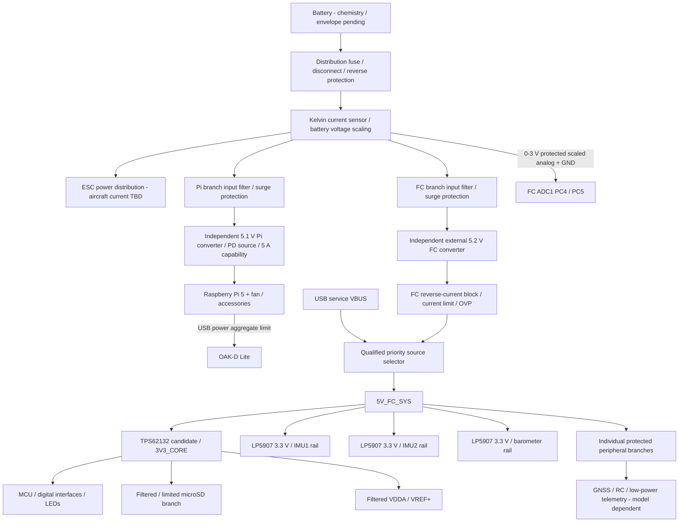

# Preliminary power tree and calculations — Stage 2

**Status: partial — architecture recommendation and transparent sizing scenarios, NOT a qualified power design.** Actual battery, motors, ESC, GNSS, receiver, radio, MCU workload and thermal environment remain unspecified. Numeric engineering allowances below are **not invented component maxima**. Sources: [M1–M8](sources.md).

## 1. Input ranges: what is and is not selected

**Recommended FC product input boundary:** external regulated **5.2 V nominal**, preliminary allowable **4.9–5.3 V at FC connector**, subject to final protection/USB source-selector tolerances. This lets high-energy/raw-battery switching and Pi heat remain off the sensitive FC. It is not approval to connect a battery directly.

**Aircraft battery input range cannot be selected as a fact yet.** Candidate to review: **ordinary 4S–6S LiPo**, assuming **4.20 V/cell maximum**, hence maximum full-charge **25.2 V**, NOT LiHV. Proposed converter evaluation sweep **10–26 V DC**, with separate surge/negative-transient qualification. The 10 V bench test floor is NOT an acceptable 4S discharge limit or a flight cutoff. Actual minimum loaded voltage, UVLO, cold starts, battery impedance and flight cutoff require user battery/ESC/motor data. If a different battery is selected, input devices, divider, UVLO and surge scheme must be recomputed. No raw-battery conversion, TVS or connector is frozen.

## 2. Domain diagram



FC and Pi converters share aircraft distribution only, not output rails. Distinct branch fusing/filtering limits Pi faults from pulling down FC supply, but shared battery/PDB is still a common failure point; no claim of redundant power.

## 3. Evidence-based loads vs open quantities

| Load | Verified specification | Nominal / peak / startup boundary |
|---|---|---|
| MCU H743 | 3.3 V within supply range; current depends on clock/VOS/peripherals [M1] | Exact mode/temperature datasheet maximum not extracted. **I_MCU,max unresolved**, must use correct table and actual measurements; no fixed consumption claimed |
| Two BMI088 | Manufacturer full-operation value 5.15 mA **each** [M2] | Known nominal total 10.30 mA. Not specified here as worst-case/startup. Use 20 mA/rail **planning allocation**, verify startup/current max separately |
| BMP388 | Pressure-measurement peak maximum 0.8 mA; temperature 0.4 mA [M3] | Conservatively allocate 1 mA rail for sensor alone; average depends on OSR/rate, nominal not frozen. I2C pull-up current additional |
| microSD | No exact card selected | Write peaks/inrush **unknown**; 400 mA planning burst allocation is not a card specification. Qualify industrial card and power-loss behavior |
| LEDs / buzzer / buffers / protection | Exact MPNs/load not frozen | Allocate after LED current, sounder and buffer selection; do not infer from reference LED resistors |
| GNSS / RC / radio | No selected models | All nominal, burst and startup currents unknown; per-port current limits cannot be finalized |
| Pi 5 | Official 5.1 V / recommended 5 A supply; 800 mA typical bare-board active figure [M7] | 800 mA is not worst-case CV power. 5 A is supply interface requirement, not a measured Pi-only load |
| OAK-D Lite | 2.5–3 W base/streaming + up to 1 W AI + 0.5 W stereo + 0.5 W encoder [M8] | Published additive upper workload scenario = **5 W**. Startup/cable/input transient peaks still unspecified; measure selected hardware/pipeline |

### Sensor loads

At 3.3 V, two nominal BMI088 loads: `3.3 × 2 × 0.00515 = 0.03399 W`. Proposed 5.2→3.3 V LDO loss per device nominal: `(5.2−3.3)×0.00515 = 0.009785 W` plus LDO IQ. At **20 mA planning allocation**, LDO loss is **0.038 W**. Using TI product θJA range approximately 187–216°C/W as a screening estimate gives **7.1–8.2°C rise**; exact chosen package/layout and dynamic current still need verification. 250 mA nameplate is not relevant proof by itself. Barometer 0.8 mA pressure peak implies **1.52 mW** LDO loss, ignoring pull-ups/IQ.

I2C1 proposal: 4.7kΩ pulls to BARO_3V3. A held-low line draws `3.3/4700=0.702 mA`, two lines **1.404 mA**; add this to rail allocation. 400 kHz fast-mode 300 ns rise-time screening with `tr≈0.8473 RC` gives `Cmax≈75 pF`; measure capacitance/rise time and lower speed/resistance if needed. This is not a reason to expose the internal bus on long cables.

## 4. FC provisional sizing scenario — explicitly an assumption set

For architecture sizing only, suppose:

* CORE load **0.8 A burst allocation** includes MCU, SD and digital overhead; this must be replaced with `I_MCU,max + I_SD,max + I_digital,max` from actual parts. Not a claim about H743 consumption.
* Two sensor LDO allocations 20 mA each; barometer rail 3 mA including pull-ups; direct 5 V board/buzzer overhead 20 mA.
* Combined external low-power peripherals **0.5 A allocation**, not verified requirements. High-power radios get their own power path if this is exceeded.
* CORE converter efficiency **90% assumption**, not a guaranteed TI operating point.

Then:

```
P_CORE_out = 3.3 × 0.8                         = 2.640 W
P_CORE_in  = 2.640 / 0.90                      = 2.933 W
P_CORE_loss= 2.933 − 2.640                      = 0.293 W
P_sensorLDO_in = 5.2 × (0.020 + 0.020 + 0.003) = 0.224 W
P_5V_board    = 5.2 × 0.020                    = 0.104 W
P_peripherals = 5.2 × 0.500                    = 2.600 W
P_FC_5V_total ≈ 5.861 W (+ conversion IQ not included)
I_FC_input   ≈ 5.861 / 5.2                     = 1.127 A
25% planning margin                           = 1.409 A equivalent
```

An external FC converter with **2 A continuous design objective** is a candidate, **not yet declared adequate**. Source selection, wiring/contact temperature rise, surge and startup could require more. Use `I_required ≥ max(steady_with_margin, sustained_peak, current-limit-compatible startup)` over temperature. For a hypothetical effective CORE thermal resistance 60°C/W, 0.293 W →17.6°C rise; **60°C/W is a scenario, not the TPS62132 guaranteed layout value**. Verify actual datasheet/PCB thermal path and ambient to junction margin.

The source selector, input eFuse/OVP, buck inductors/capacitors, port current-limit switches and supervisor MPNs remain TBD. Full upstream/downstream limit coordination must precede schematic release. A 3 A buck output rating does not establish SD burst performance or safe overload behavior.

## 5. Pi 5 + OAK-D Lite budget

Official Pi guidance [M7]: 5.1 V, recommended 5 A supply; with capable supply USB aggregate current up to **1.6 A**, otherwise **600 mA**. Firmware/source detection/configuration must be correct; a generic 5 V buck is **not automatically a recognized 5 A USB-C source**. Recommend a correctly designed USB-PD source advertising supported 5 V/5 A operation, protected VBUS and an appropriately 5 A-rated/e-marked cable. USB-PD controller and source-policy implementation remain TBD; do not fake CC resistors to advertise 5 A.

Camera arithmetic from published workloads:

```
P_OAK_workload = 3 + 1 + 0.5 + 0.5 = 5.0 W
I_OAK_equiv at 5.0 V                = 1.0 A
```

This is above Pi's 600 mA low-power USB limit (3 W), below 1.6 A aggregate (8 W). At 1 A OAK scenario, **0.6 A USB current headroom** remains for all other USB accessories before cable drops/peaks. These are workload calculations, not measured camera startup maxima. Use no extra high-load USB accessories initially. If actual camera peaks violate port/power limits, use a separately powered USB3 hub engineered from the Pi branch, without VBUS backfeeding the Pi.

**Do not add camera power twice.** The 5.1 V×5 A=**25.5 W total Pi-input design envelope** includes downstream USB draw, onboard losses, fan and other connected loads. Within that scenario a 5 W camera leaves **20.5 W** for Pi/fan/accessories/losses; this is an available budget, not a proven Pi maximum. If measured total exceeds envelope or USB policy, revise the power path.

Converter-loss sensitivity at 25.5 W output:

| Assumed conversion efficiency (not guaranteed) | Battery-side power | Converter heat |
|---|---:|---:|
| 85% | 30.00 W | 4.50 W |
| 90% | 28.33 W | 2.83 W |
| 95% | 26.84 W | 1.34 W |

At **90% assumed efficiency**, input current would be `28.33/VBAT`: **2.833 A at 10 V**, **1.124 A at 25.2 V** (evaluation points, not approved battery limits). Distribution also carries ESC + FC power; these numbers do not size main battery connectors. For a 125°C engineering junction limit and hypothetical 60°C ambient, 2.83 W requires effective thermal resistance **≤22.9°C/W**; 4.5 W requires **≤14.4°C/W**. These are board-level thermal targets, not claims that candidate regulator meets them. Need measured efficiency/temperature in enclosure/airflow conditions, inductive loss and heat spreading.

**Candidate only:** LM61460-Q1 (manufacturer active, 3–36 V, 6 A). 6 A vs 5 A provides nominal 20% current-rating headroom, but derating/inductor ripple, saturation, current limit, loop stability and thermal capability may erase it. It is not approved just because it says 6 A. An off-the-shelf documented UAV-qualified module with adequate measured behavior may reduce risk versus developing both DC/DC modules immediately.

### Cable/startup/transient screening

* For 5 A and a hypothetical **30 mΩ total loop**, drop `IR=0.15 V`, cable/contact heat `I²R=0.75 W`. Measure voltage **at Pi input**, not converter pads; correct setpoint only within documented Pi tolerance, never blindly overvoltage to offset unknown cable resistance.
* For an example **2 A / 100 µs load step** and **0.15 V droop allocation**, ideal `C=IΔt/ΔV=1333 µF`. If ESR=20 mΩ causes 40 mV immediate step, remaining 110 mV requires **1818 µF effective**. This is an illustrative hold-up calculation, **not a blanket capacitor prescription**: real loop response, ceramic derating, cable inductance, startup and PD stability decide values.
* Charging hypothetical 2 mF to 5.1 V in 10 ms adds **1.02 A inrush**; combined load may exceed source current limit. Control soft-start/precharge/source enable and Pi startup sequence; verify UVLO/hiccup behavior. Camera enumeration adds another transient.
* Validate battery hot-plug, ESC regenerative/braking transients, long-lead ringing, rapid throttle changes, camera load changes, Pi boot/reboot and output short circuits. Clamp residual surge **below the lowest downstream absolute maximum with tolerance**, not merely below TVS standoff. A 36 V rating is not a clamped surge specification.

## 6. Protection, sensing, sequencing and grounding

**Battery/PDB:** fuse/branch protection selected from actual conductor/connector/ESC current; reverse-polarity MOSFET/ideal-diode path; TVS/snubbers/filter from measured energy/impedance; inductor saturation/capacitor bias/ripple and wet/contaminated clearances reviewed. No imported 30 V TVS is accepted by default. Select current sensor/shunt only after current range is known: `Rshunt≤P_allowed/Imax²`, signal `V=I×Rshunt×gain+offset`; Kelvin route, prove resolution/temperature drift and ADC headroom.

**FC sensing boundary:** external module produces protected low-impedance 0–3.0 V scaled voltage/current outputs referenced to FC GND. MCU ADC1 PC4/PC5 with RC/series/clamp to safe rail and injection-safe power-off state. No raw VBAT divider placed on FC by default. Transfer ratio, Vref calibration, sampling time, offset and PX4 BAT parameters are module-specific. Two doubled power contacts are not automatically twice the current rating; verify current sharing and harness crimp/contact limits.

**FC startup:** protected 5V_FC_SYS → 3V3_CORE PG/reset supervisor → enable IMU rails with default-safe hardware pulls and firmware-controlled reset capability → wait datasheet startup → release CS/pin states/start drivers. Barometer rail enabled from validated core-good path. During any rail-off interval MCU bus outputs must be high impedance or appropriately isolated; do not power-cycle sensor supply while driving its pins. LDO output discharge/reverse conduction and bus isolation need explicit circuit verification. Record rails/NRST/CS waveforms and brownout cause.

USB service source must be current-limited and reverse-current isolated; peripheral power can be disabled in service-only mode. USB host must not power Pi/ESC/radio unintentionally. No battery into MCU VBAT pin (tie to 3V3_CORE in Rev A). VDDA/VREF+ filter must not violate power-order/injection requirements; VCAP capacitors follow exact ST specification. All rail bulk/100 nF placement follows pin-level datasheet audit; no unqualified blanket capacitor list.

**Returns:** continuous local FC ground planes; no analog split that breaks digital return paths. High-current ESC phase/battery and Pi returns close at PDB. Ground travels with UART/ESC/GNSS signals; avoid an accidental FC-to-Pi USB+UART power/ground loop (FC-Pi USB not default). Keep regulator hot loops compact, shield/route away from IMUs/barometer/GNSS antenna cable. Regulator frequency/buzzer harmonics must be checked in gyro spectra. Pi reset/overload may not reset FC; verify with real wiring.

**Open before release:** actual battery/loads, part-specific budgets, effective efficiency maps, startup peaks, thermal stack, fuse/TVS/OVP/controller/cable MPNs, PD source validation and manual instrumented power tests. No regulator, battery range or connector is release-qualified by this document.
